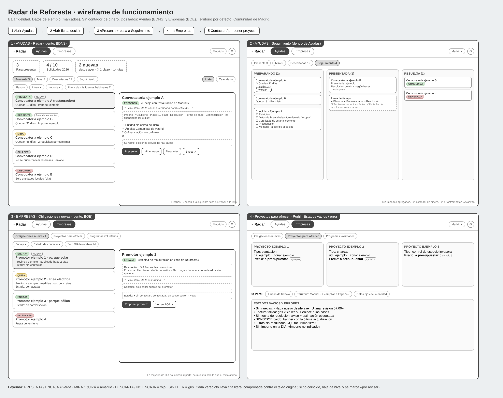

# Radar de Reforesta · documento de traspaso para diseño

Estado de la propuesta tras la revisión de flujo. Está pensado para quien tenía el diseño anterior: resume **qué ha cambiado**, **cómo queda la estructura** y **qué falta por confirmar**. Wireframe de baja fidelidad: [`../wireframe/radar-wireframe.png`](../wireframe/radar-wireframe.png).

> Convención: **(S)** = suposición no confirmada. Todos los datos del wireframe son de ejemplo y están rotulados así.

---

## 1. Resumen en cinco líneas

1. Foco: **reforestación**. Se descartan conservación, charcas, especies invasoras y educación ambiental.
2. La app tiene **tres apartados** más el perfil: **Ayudas** (fuente BDNS), **Empresas** (fuente BOE) y **Propuestas** (oferta de Reforesta con página pública).
3. **Se elimina el contador de dinero conseguido.** Sus cifras eran inventadas y no ayudaba a decidir.
4. La IA lee y traduce, pero **no redacta propuestas**. Todo veredicto lleva una cita literal comprobada contra el texto original.
5. Territorio por defecto: **Comunidad de Madrid**, con interruptor "ampliar a toda España".

## 2. Qué ha cambiado respecto al diseño anterior

| Tema | Antes | Ahora |
|---|---|---|
| Contador de dinero conseguido | Pantalla principal | **Eliminado** |
| Cabecera | Dinero y reparto por origen | "Para presentar: N" y "Solicitudes 2026: n de 10" |
| Estructura | Radar + pestaña de empresas | **Ayudas · Empresas · Propuestas** (+ Perfil) |
| Seguimiento | Apartado propio | **Pestaña dentro de Ayudas** |
| Empresas | Programas RSC curados | **Obligaciones del BOE** (DIA favorables con medidas de reforestación) |
| Propuestas | No existía | **Nuevo:** catálogo + reservas + página pública |
| Líneas de trabajo | Varias | **Solo reforestación** |
| Territorio | No definido | Madrid por defecto, editable |
| Importes en DIA | Se mostraban | Solo si el texto los dice; si no, "importe no indicado" |
| Fuentes de ayudas | Solo BDNS | BDNS + 3–5 fundaciones privadas curadas a mano |

## 3. Estructura de la herramienta

| Apartado | Pregunta que responde | Quién lo usa |
|---|---|---|
| **Ayudas** | ¿A qué convocatorias presento solicitud? | Equipo |
| **Empresas** | ¿A qué empresa recién obligada a reforestar le puedo ofrecer ejecutarlo? | Equipo |
| **Propuestas** | ¿Qué ofrecemos y quién ha reservado? | Equipo (gestión) y empresas (página pública) |
| **Perfil** (engranaje) | ¿Qué sabe la herramienta de nosotros? | Equipo |

### 3.1 Ayudas (fuente: BDNS)

- **Cabecera:** "Para presentar: N", "Solicitudes 2026: n de 10", nuevas desde ayer y plazo más próximo.
- **Pestañas:** Presenta · Mira · Descartadas · Seguimiento. Interruptor Lista / Calendario.
- **Filtros visibles:** plazo, importe y "fuera de mis fuentes habituales". El resto, en "más filtros".
- **Ficha lateral**, en este orden:
  1. veredicto, motivo en una frase y cita literal;
  2. cifras clave: importe, % cubierto, plazo con "quedan N días", resolución, forma de pago (anticipado o tras justificar) y cofinanciación;
  3. requisitos con ✓ / ? / ✕;
  4. "Se repite": ediciones anteriores, si hay datos;
  5. botones **Presentar · Mirar luego · Descartar** y enlace a las bases.
- **Seguimiento:** Preparando → Presentada → Resuelta (concedida / denegada), con checklist de documentos y línea de tiempo. **Sin importes agregados.**
- **Orden de la lista:** primero el veredicto, luego el plazo, luego el importe. Sin puntuación numérica.
- Las **descartadas son visibles y justificadas**, para que el equipo pueda auditar lo que la herramienta rechaza.

### 3.2 Empresas (fuente: BOE)

- Se leen las resoluciones de **Declaración de Impacto Ambiental (DIA)** y se conservan solo las **favorables con medidas de reforestación**. Se descartan las desfavorables y las modificaciones de condiciones.
- **Tarjeta:** promotor, proyecto, provincia, medidas, hectáreas (si el texto las dice), plazo legal, importe (**"no indicado" si no aparece**), cita literal y enlace al BOE.
- **Veredicto:** Encaja / Quizá / No encaja. Estado de contacto: sin contactar / contactada / en conversación, con una línea de nota.
- **Contacto:** solo el canal público del promotor. Nunca datos inventados.
- Botón **"Enviar propuesta (enlace)"**: copia el enlace a una propuesta concreta para mandarlo al promotor.
- Los programas voluntarios de RSC quedan como filtro secundario, con 3–4 entradas curadas.

### 3.3 Propuestas (nuevo)

**Vista del equipo**
- "Mis propuestas": estado (publicada / reservada / borrador), plazas libres, enlace público.
- "Reservas recibidas": **Recibida → En conversación → Aceptada / Rechazada → Completada.** Aceptar descuenta la plaza.

**Página pública para empresas** (sin login)
- Tarjetas con tipo, zona, qué incluye, plazas libres y precio **"a presupuestar"** (o marcado como ejemplo).
- Botón **"Reservar sin compromiso"**: formulario con empresa, persona de contacto, email y mensaje, más casilla de consentimiento de datos.
- Confirmación: "Reserva recibida. Reforesta te responderá en unos días. No supone compromiso de pago."
- Sin pagos ni cuenta de usuario.
- Opcional: asistente **"Dime qué buscas"** (3–4 preguntas con opciones). Propone **solo propuestas del catálogo**, por reglas, con "por qué encaja". Si nada encaja, "Cuéntanos tu idea" envía una solicitud a medida a la bandeja del equipo.

### 3.4 Perfil

Línea de trabajo (reforestación), territorio (Madrid + "ampliar a España") y datos fijos de la entidad para autorrellenar el checklist. Solo lectura el sábado, salvo los datos fijos.

## 4. Flujo de uso (sesión de 10 minutos)

1. **Abrir Ayudas:** cabecera, pestaña "Presenta" activa y nuevas arriba.
2. **Abrir la primera ficha**, leer el motivo, las cifras y los requisitos, y decidir en un solo clic. "Descartar" pide un motivo en un toque.
3. **Pasar a la siguiente ficha con las flechas**, sin volver a la lista.
4. **"Presentar" crea el seguimiento** con su checklist.
5. **Ir a Empresas:** revisar obligaciones nuevas, cambiar el estado de contacto o enviar el enlace de una propuesta.
6. **Ir a Propuestas:** responder a reservas recibidas (aceptar, rechazar o pasar a conversación).

## 5. Estados vacíos y errores (hay que diseñarlos)

| Situación | Qué ve el usuario |
|---|---|
| Sin convocatorias nuevas | "Nada nuevo desde ayer. Última revisión 07:00" + las de plazo más próximo |
| Falla la lectura de las bases | Gris "Sin leer" + datos de la BDNS + enlace; sin datos inventados |
| Sin fecha de resolución | "Las bases no indican fecha" + estimación etiquetada si hay ediciones previas |
| BDNS o BOE no responden | Banner con la fecha de la última actualización |
| Filtros sin resultados | "Quitar último filtro" |
| DIA sin importe | "Importe no indicado" |
| Sin reservas | "Aún no hay reservas. Comparte el enlace" |
| Página pública sin propuestas | "Pronto habrá proyectos" |
| Propuesta sin plazas | "Sin plazas" + "Avisarme" |
| Error al enviar la reserva | Mensaje claro y datos del formulario conservados |
| Reserva duplicada | "Ya has reservado esta propuesta" |

## 6. Reglas de calidad (afectan al diseño de las fichas)

- **Cita literal comprobada:** si no aparece tal cual en el texto original, el veredicto baja un nivel y se marca "por revisar".
- **No se muestra un dato que el texto no diga.** Mejor "no indicado" que una cifra inventada.
- **Todo lo estimado se etiqueta** como estimación o ejemplo.
- **La IA no redacta propuestas.** Solo lee, filtra y prepara.

## 7. Datos reales y de ejemplo

| Real (si las fuentes responden) | Curado a mano o ejemplo |
|---|---|
| Convocatorias de la BDNS y su lectura | Fundaciones privadas (curadas) |
| DIA del BOE con su cita | Propuestas y sus precios |
| Veredictos sobre texto real | Perfil de Reforesta (suposiciones marcadas) |

## 8. Lo que sabemos de Reforesta (búsqueda pública)

- Asociación sin ánimo de lucro fundada en 1991 y declarada de utilidad pública.
- Actúa sobre todo en la **Comunidad de Madrid** (Sierra de Guadarrama, Soto del Real, Villamanrique de Tajo) y ha hecho al menos una iniciativa en **Cataluña** con Fundación Alstom.
- Ya colabora con empresas (Alstom, GMV, Repsol, International Paper, Logista). **El canal de empresas existe pero parece poco estructurado (S).**
- Un proyecto suyo figura en una convocatoria de Montemadrid (fundación privada), que **no está en la BDNS**.

Fuentes: [Corresponsables](https://www.corresponsables.com/actualidad/medioambiente/fundacion-alstom-y-asociacion-reforesta-ponen-en-marcha-una-iniciativa-de-reforestacion-en-madrid-y-cataluna/) · [Alstom](https://www.alstom.com/es/press-releases-news/2024/12/fundacion-alstom-y-asociacion-reforesta-ponen-en-marcha-una-iniciativa-de-reforestacion-en-madrid-y-cataluna) · [Montemadrid, VI Convocatoria](https://www.fundacionmontemadrid.es/wp-content/uploads/2024/09/PROYECTOS-VI-CONVOCATORIA-MEDIOAMBIENTE-Y-DESARROLLO-SOSTENIBLE.pdf).

## 9. Fuentes técnicas

- **BDNS:** API pública que devuelve JSON, con Swagger en `infosubvenciones.es/bdnstrans/doc/swagger`. **No se ha podido probar desde el entorno de desarrollo (bloqueado).** Hay que copiar los nombres reales de los parámetros desde el Swagger. Limitar a unas 1 petición por segundo.
- **BOE:** API oficial del sumario diario, `GET /datosabiertos/api/boe/sumario/AAAAMMDD` (JSON o XML). No hay filtro por tipo de resolución: habrá que filtrar por departamento y título. Documentación: [APIsumarioBOE.pdf](https://boe.es/datosabiertos/documentos/APIsumarioBOE.pdf).
- **Riesgo conocido:** muchas DIA describen las medidas sin cifras ni importes. La extracción debe distinguir "plantación o revegetación" de "gestión de hábitat" (por ejemplo, aves esteparias), que no es reforestar.

## 10. Plan para el sábado

**Orden**

1. Comprobar BDNS y BOE; guardar unas 40 convocatorias y 20–30 DIA reales como copia local.
2. Esquemas JSON de extracción (ayudas y DIA) y comprobación automática de la cita.
3. Procesar el lote y revisar a mano al menos 10 resultados.
4. Ayudas: lista, ficha y botones; luego Seguimiento.
5. Empresas: tarjetas de obligaciones y estado de contacto.
6. Propuestas: catálogo, página pública, formulario de reserva y bandeja.
7. Calendario reducido, asistente "Dime qué buscas", README y vídeo.

**Orden de recorte si falta tiempo:** calendario → asistente "Dime qué buscas" → línea de tiempo del seguimiento. **No se recorta:** BDNS con veredicto y cita, ni BOE con DIA favorables.

**Futuro (fuera del sábado):** BOE autonómico (BOCM, DOG), concesiones de la BDNS como lead, hectáreas por hora de trabajo, cartera óptima, avisos por email, pagos, mapa de proyectos, cuenta de empresa, resumen semanal.

## 11. Preguntas abiertas

1. ¿Responde la BDNS y se pueden leer las bases completas? ¿Cuántas convocatorias de reforestación abiertas hay de verdad?
2. ¿Qué porcentaje de DIA favorables incluye hectáreas o importe? ¿Cuántas al mes caen en Madrid?
3. ¿Qué empresas han financiado ya a Reforesta y de qué forma (voluntariado, donación, convenio)?
4. ¿Puede Reforesta ejecutar fuera de Madrid y como contratista de una empresa obligada?
5. ¿Qué 3–5 propuestas reales ofrecería, con qué capacidad y quién respondería a las reservas?
6. ¿Pueden adelantar el dinero o necesitan pago previo? ¿Cuál es el importe mínimo que les compensa?
7. ¿Quieren una página pública o un enlace privado? ¿Cómo cumplen con la protección de datos del formulario?

## 12. Qué necesito del diseño

- Maquetar las **seis pantallas del wireframe** con la identidad ya decidida (estilo limpio, fondo blanco, verde y azul, iconos muy redondeados, escritorio responsive).
- Diseñar los **estados vacíos y de error** de la sección 5.
- Definir cómo se ven los **tres semáforos** (Presenta/Mira/Descarta, Encaja/Quizá/No encaja, Sin leer) y la etiqueta **"ejemplo"**, de forma que no se confunda un dato real con uno de ejemplo.
- Cuidar que la **página pública** se perciba como un espacio distinto del interno: sin menú del equipo y con tono para empresas.
